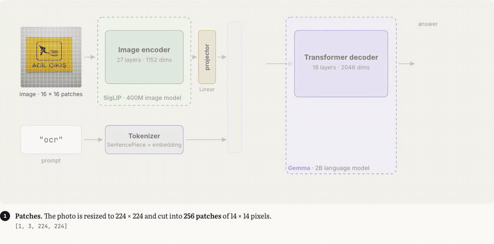
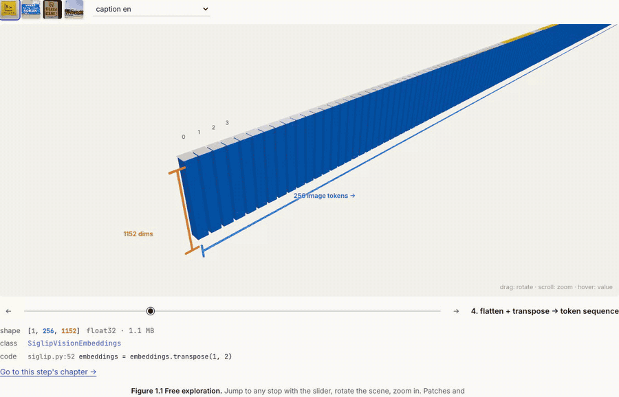
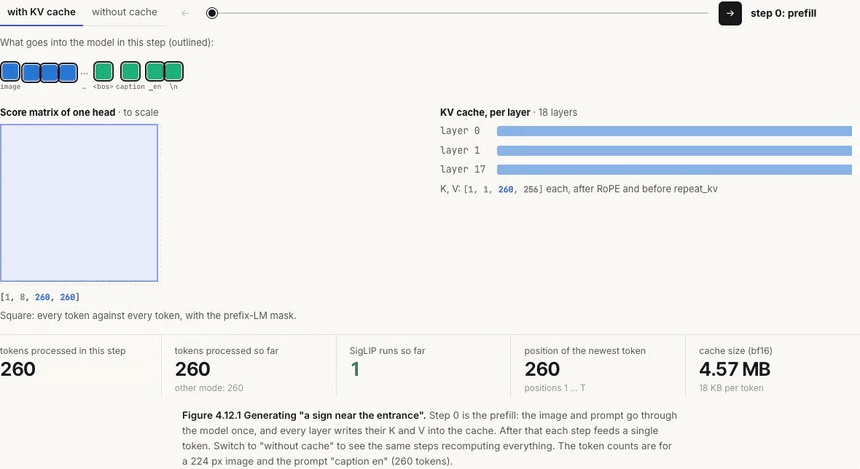
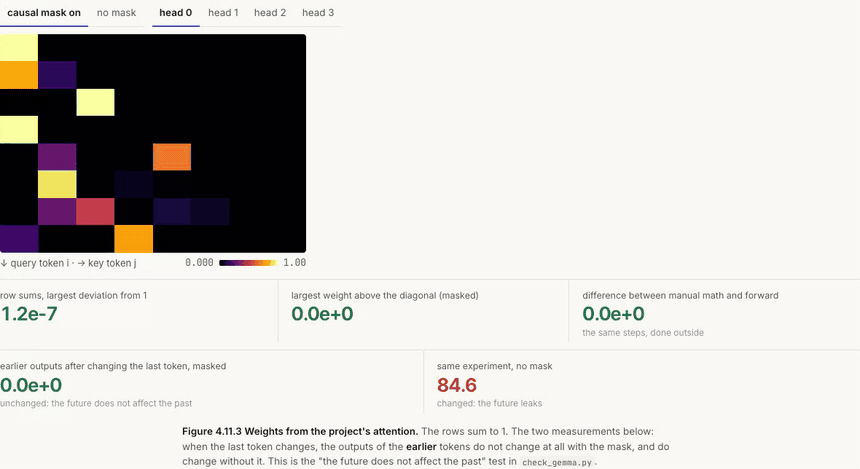
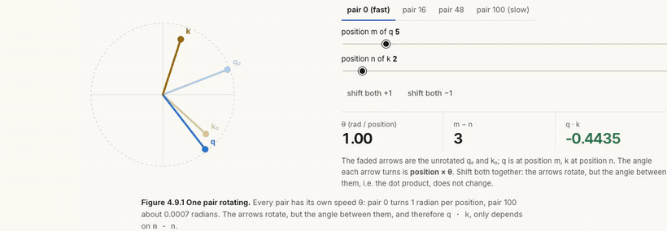
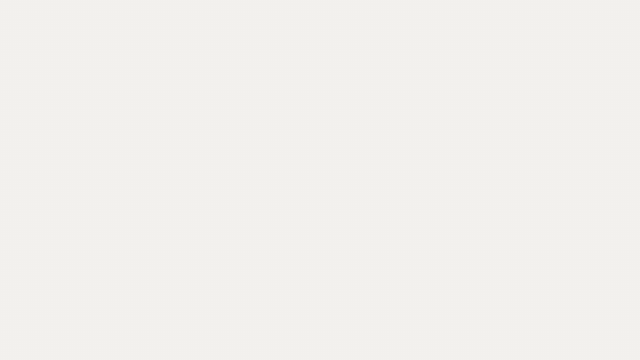

# PaliGemma from scratch

A from-scratch PyTorch implementation of Google DeepMind's PaliGemma vision-language model, checked against Hugging Face `transformers` piece by piece, plus an interactive handbook that explains every part of it.

<p align="center"></p>

**[Open the interactive handbook →](https://mlihgenel.github.io/paligemma-from-scratch/)** (English and Turkish)

## What this is

PaliGemma looks at an image and writes text about it: captions, OCR, answers to questions, even bounding boxes. Inside it there are three parts:

1. **SigLIP** cuts a 224 × 224 image into 256 patches of 14 × 14 pixels and turns each one into a 1152-dim vector (27 transformer layers).
2. **A single linear layer** moves those vectors to the language model's size (2048).
3. **Gemma** (2B, 18 layers) reads the 256 image tokens followed by the prompt and writes the answer token by token. Image and prompt attend to each other in both directions (a prefix-LM mask), while the answer only looks back.

This repo rebuilds all of that in plain PyTorch, about 600 lines in `src/`, with no `transformers` model code. The released `google/paligemma-3b-pt-224` weights are loaded into it, and every part is compared with the Hugging Face implementation. Nothing is trained.

## Results

All comparisons use the real `google/paligemma-3b-pt-224` weights in bf16 on a Colab GPU (`notebooks/verify_paligemma_pt_224.ipynb`), with the HF reference running eager attention.

| Check | Result |
|---|---|
| Processor (`input_ids`, `pixel_values`) | identical ids, pixel difference within 1/255 |
| Logits for a full 260-token input | max difference **0.000**, argmax equal at 100% of positions |
| Layer by layer (27 SigLIP + projector + 18 Gemma layers) | relative error **0** at every block |
| Same weights in float32 on CPU | relative error ~1e-7 |
| Greedy generation vs HF `generate(do_sample=False)` | **token for token identical** |
| KV cache vs uncached vs HF | identical tokens, also for 64 tokens without eos |

The local checks in `checks/` compare each module with its HF counterpart on random weights and small configs, so they run on a laptop without downloading the 6 GB model.

## The handbook

The handbook is a Vite + React site that reads the code in `src/` live and runs real computations: slices of the real weights, the project's own modules run on toy sizes, and 3D and 2D figures you can rotate, drag and step through. There are 18 chapters, from the image preprocessing to the KV cache, each in English and Turkish.

<table>
<tr>
<td width="50%"><br><sub><b>End to end.</b> A photo passes through the model with its real shapes.</sub></td>
<td width="50%"><br><sub><b>KV cache.</b> Prefill once, then one token per step.</sub></td>
</tr>
<tr>
<td><br><sub><b>Attention.</b> Weights from the project's <code>GemmaAttention</code>, with and without the causal mask.</sub></td>
<td><br><sub><b>RoPE.</b> Shifting both positions rotates q and k but keeps q · k.</sub></td>
</tr>
<tr>
<td colspan="2" align="center"><br><sub><b>The residual stream.</b> Each branch reads a normalized copy of the stream and adds an update (Manim).</sub></td>
</tr>
</table>

## Repository layout

```text
src/
  siglip.py        SigLIP vision encoder: patch embedding, attention, MLP, 27 encoder layers
  processing.py    image preprocessing and the PaliGemma processor (256 <image> tokens + prompt)
  gemma.py         Gemma: RMSNorm, GeGLU MLP, RoPE, MQA attention, KV cache, decoder, LM head
  paligemma.py     the full model: projector, merging image and text, prefix-LM mask, HF weight loader
  generate.py      greedy decoding, with or without the KV cache
checks/            module-by-module comparisons with HF, plus a KV cache benchmark
notebooks/         Colab notebook that verifies the model against the real weights
handbook/          the interactive handbook (Vite + React + three.js), its data exports and Manim scenes
assets/            README media and a sample image used by the checks
```

## Quickstart

```bash
python -m venv .venv && source .venv/bin/activate
pip install -r requirements.txt

# module checks: random weights, nothing large is downloaded
python checks/check_gemma.py
python checks/check_paligemma.py
python checks/check_projector.py

# these download siglip-base (~800 MB) and the PaliGemma tokenizer
hf auth login        # accept the license on huggingface.co/google/paligemma-3b-pt-224 first
python checks/check_embeddings.py
python checks/check_encoder.py
python checks/check_processing.py
```

To check the full 3B model against the real weights, open `notebooks/verify_paligemma_pt_224.ipynb` in Colab and follow the steps at the top.

Using the model directly (the weights are taken from the HF checkpoint, so both models are briefly in memory; the notebook shows a GPU-friendly order):

```python
import sys; sys.path.insert(0, "src")
import torch
from PIL import Image
from transformers import AutoTokenizer, PaliGemmaForConditionalGeneration as HFPaliGemma
import paligemma, processing, generate

hf = HFPaliGemma.from_pretrained("google/paligemma-3b-pt-224", torch_dtype=torch.bfloat16)
torch.set_default_dtype(torch.bfloat16)          # build in bf16; the RoPE frequencies stay float32
model = paligemma.PaliGemmaForConditionalGeneration(paligemma.PaliGemmaConfig()).eval()
torch.set_default_dtype(torch.float32)
paligemma.load_hf_weights(model, hf.state_dict())
del hf

tokenizer = AutoTokenizer.from_pretrained("google/paligemma-3b-pt-224")
proc = processing.PaliGemmaProcessor(tokenizer, num_image_tokens=256, image_size=224)
inputs = proc(text=["caption en"], images=[Image.open("assets/sample_sign.jpg").convert("RGB")])
tokens = generate.generate(model, inputs["input_ids"], inputs["pixel_values"].to(torch.bfloat16),
                           inputs["attention_mask"], max_new_tokens=20, eos_token_id=tokenizer.eos_token_id)
print(tokenizer.decode(tokens[0], skip_special_tokens=True))
```

### Running the handbook locally

The handbook's data comes from small slices of the gated PaliGemma checkpoint, so it has to be generated with your own Hugging Face access:

```bash
for s in fetch_paligemma_slices export_pipeline export_model_tree export_attention export_gemma_toy export_golden; do
  python handbook/export/$s.py
done
bash handbook/manim/render.sh     # optional: the animations, needs `pip install manim`

cd handbook && npm install && npm run dev
```

`npm test` runs the unit tests of the in-browser math against PyTorch values, and `npx playwright test` (with the dev server running) smoke-tests every page in both languages.

## Background

This project follows the PaliGemma papers and the Hugging Face implementation:

- Beyer, L., Steiner, A., Pinto, A. S., et al. *PaliGemma: A versatile 3B VLM for transfer.* 2024. [arXiv:2407.07726](https://arxiv.org/abs/2407.07726)
- Steiner, A., Pinto, A. S., Tschannen, M., et al. *PaliGemma 2: A Family of Versatile VLMs for Transfer.* 2024. [arXiv:2412.03555](https://arxiv.org/abs/2412.03555)
- Zhai, X., et al. *Sigmoid Loss for Language Image Pre-Training.* ICCV 2023. [arXiv:2303.15343](https://arxiv.org/abs/2303.15343)
- [Hugging Face `transformers`](https://github.com/huggingface/transformers): `modeling_paligemma.py`, `modeling_gemma.py`, `modeling_siglip.py`
- Umar Jamil's video *Coding a Multimodal (Vision) Language Model from scratch in PyTorch* and Tunga Bayrak's SigLIP walkthrough, which this code started from

Related writing by the author (in Turkish): a critical review of the PaliGemma 2 paper, [*Göz mü, Beyin mi?*](https://medium.com/@mlihgenel/g%C3%B6z-m%C3%BC-beyin-mi-bir-g%C3%B6rsel-dil-modeline-nereden-yat%C4%B1r%C4%B1m-yapmal%C4%B1-342456927efa), and an [experiment](https://github.com/mlihgenel/paper-to-practice/tree/main/papers/01-paligemma2/experiment) comparing 224 px and 448 px on Turkish street signs and receipts.

## License and credits

The code is released under the [MIT License](LICENSE).

The model weights are not part of this repository. The handbook site shows small slices of `google/paligemma-3b-pt-224`, which is provided under and subject to the [Gemma Terms of Use](https://ai.google.dev/gemma/terms).

Example photos are from Wikimedia Commons: *Acil çıkış* and *Köprülü Mehmet Paşa Sokak tabelası* by Vikiçizer (CC BY-SA 4.0), *Çınarcık Sign* by Wiki leylek (CC BY 4.0), and *Don't Smoke written in Turkish* by Ibrahim Husain Meraj (CC BY-SA 3.0). Details and links are in [`handbook/export/images/CREDITS.md`](handbook/export/images/CREDITS.md). `assets/sample_sign.jpg` and the GIFs that show it are derived from Vikiçizer's photo under CC BY-SA 4.0.
